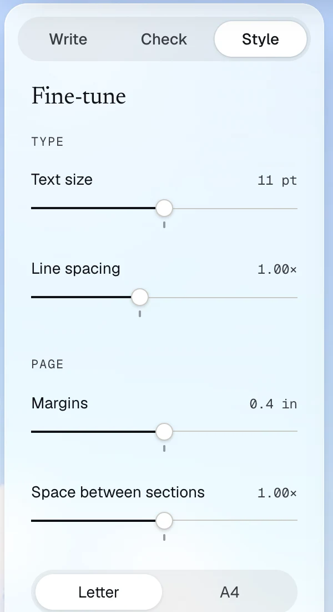
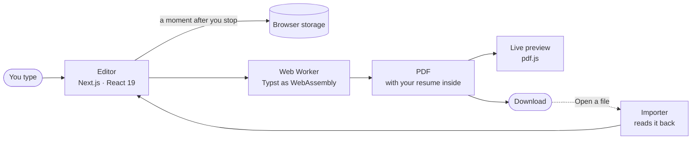

<a href="https://www.tryresumezip.com">
  
</a>

<p align="center">
  <b>A free, open-source resume builder that runs in your browser.</b><br>
  Make your resume ATS-friendly and catch what you missed before a recruiter does.<br>
  No account, and no copy on our side.
</p>

<p align="center">
  <a href="https://www.tryresumezip.com"><b>Start writing →</b></a>
  &nbsp;·&nbsp;
  <a href="https://www.tryresumezip.com/templates">Templates</a>
  &nbsp;·&nbsp;
  <a href="https://www.tryresumezip.com/review">Review a resume</a>
  &nbsp;·&nbsp;
  <a href="#run-it-yourself">Run it yourself</a>
  &nbsp;·&nbsp;
  <a href="https://github.com/ian-hoang/resumezip/issues/new/choose">Report a bug</a>
</p>

<p align="center">
  <a href="https://github.com/ian-hoang/resumezip/actions/workflows/ci.yml"></a>
  <a href="LICENSE"></a>
  
  
  <a href="https://github.com/ian-hoang/resumezip/stargazers"></a>
</p>

## Why resumezip

<table>
  <tr>
    <td width="33%" valign="top"><b>No account</b><br>Open it and start writing. Free, with no trial, no watermark and nothing to install.</td>
    <td width="33%" valign="top"><b>Private by design</b><br>Your resume is saved in your browser and the PDF is made on your device. We don't store it.</td>
    <td width="33%" valign="top"><b>Live preview</b><br>The real PDF updates as you type, so what you see is what you send.</td>
  </tr>
  <tr>
    <td valign="top"><b>Reads well to hiring software</b><br>Real text, no icons or graphics, and links printed as text, so applicant tracking systems read every word.</td>
    <td valign="top"><b>Bring your old resume</b><br>Open a PDF or Word file and it's sorted into the editor's fields for you to check. It's read in your browser, not uploaded.</td>
    <td valign="top"><b>Your PDF is your save file</b><br>Every PDF carries its resume, so it opens again on any computer and you keep editing.</td>
  </tr>
</table>

## Write, check, style

<table>
  <tr>
    <td width="33%" align="center" valign="top">
      <br>
      <b>Write</b><br>
      <sub>Fill in each section beside the live page. Drag sections into any order, add your own, and leave out what doesn't fit this job.</sub>
    </td>
    <td width="33%" align="center" valign="top">
      <br>
      <b>Check</b><br>
      <sub>An ATS score out of 100 and what to fix, marked on the page: weak bullets, dates, missing sections, spelling and grammar, all checked in your browser. Or ask for AI notes.</sub>
    </td>
    <td width="33%" align="center" valign="top">
      <br>
      <b>Style</b><br>
      <sub>Text size, line spacing, margins and the space between sections, Letter or A4, and a switch that keeps it to one page.</sub>
    </td>
  </tr>
</table>

## Review a resume you already have

<table>
  <tr>
    <td width="50%" valign="top"><a href="https://www.tryresumezip.com/review"></a></td>
    <td width="50%" valign="middle">
      <b>Your resume has 7 seconds.</b><br><br>
      Drop a PDF or Word file on the <a href="https://www.tryresumezip.com/review">review page</a> and see what a recruiter would skip, marked right on the page, with an ATS check beside it. It's free.<br><br>
      <sub>The resume's text goes to AI for the review. Past reviews are kept only in your browser.</sub>
    </td>
  </tr>
</table>

## Templates

<table>
  <tr>
    <td align="center"><a href="https://www.tryresumezip.com/templates/jakes"></a><br>Jake's</td>
    <td align="center"><a href="https://www.tryresumezip.com/templates/modern-jakes"></a><br>Modern Jake's</td>
    <td align="center"><a href="https://www.tryresumezip.com/templates/blueprint"></a><br>Blueprint</td>
    <td align="center"><a href="https://www.tryresumezip.com/templates/compact"></a><br>Compact</td>
  </tr>
  <tr>
    <td align="center"><a href="https://www.tryresumezip.com/templates/ians"></a><br>Ian's</td>
    <td align="center"><a href="https://www.tryresumezip.com/templates/harvard"></a><br>Harvard</td>
    <td align="center"><a href="https://www.tryresumezip.com/templates/margin"></a><br>Margin</td>
    <td align="center"><a href="https://www.tryresumezip.com/templates/swiss"></a><br>Swiss</td>
  </tr>
  <tr>
    <td align="center"><a href="https://www.tryresumezip.com/templates/mono"></a><br>Mono</td>
    <td align="center"><a href="https://www.tryresumezip.com/templates/accent"></a><br>Accent</td>
    <td align="center"><a href="https://www.tryresumezip.com/templates/deedy"></a><br>Deedy</td>
    <td align="center"><a href="https://www.tryresumezip.com/templates/zero2sudo"></a><br>zero2sudo</td>
  </tr>
  <tr>
    <td align="center" valign="middle" colspan="4"><a href="https://www.tryresumezip.com/templates"><b>See them all →</b></a></td>
  </tr>
</table>

Switch templates any time; your words stay put.

## Every format you need

| Format | Download it | Open it again |
| --- | --- | --- |
| **PDF** | Hiring-software friendly, with your resume tucked inside | Yes, exactly as you left it |
| **Word** (.docx) | To edit in Word, Google Docs or Pages | Yes, exactly, until another app saves it; then it's read like any Word file |
| **LaTeX** (.tex) | To edit on Overleaf, laid out like your PDF | No |
| **JSON** | A backup with everything, even what the PDF leaves out | Yes, and Download all backs up every resume at once |
| **Google Drive** | Puts the PDF in your Drive. Google asks you first. | |

You can also open a PDF or Word resume made anywhere else: resumezip sorts it into the editor's fields for you to check.

## Privacy, plainly

resumezip has no accounts and no analytics, and keeps no copy of your resume. It stays in your browser unless you send it somewhere, or get AI notes on it.

| What | Where it happens |
| --- | --- |
| Your resumes | Saved in this browser's storage. That's the only copy. |
| Past reviews | Kept in this browser, with the file you reviewed: the latest 20 |
| Making the PDF | On your device, with [Typst](https://typst.app) running as WebAssembly |
| Spelling and grammar | On your device, with [Harper](https://github.com/Automattic/harper) |
| Opening a PDF or Word file | On your device. Nothing is uploaded. |
| AI notes, for a resume you review on the review page or ask about in the editor | Its text goes through resumezip's one server function to Claude, run by Anthropic, or GPT, run by OpenAI or Microsoft Azure. We don't keep it. |

The only other requests: the PDF engine and the spelling checker download from [jsDelivr](https://www.jsdelivr.com) (files only, nothing of yours goes with them), Save to Google Drive talks to Google when you choose it, and adding a paper by its DOI or link asks [Crossref](https://www.crossref.org) or [doi.org](https://www.doi.org) for its details.

> [!NOTE]
> Safari deletes a site's data after seven days of Safari use without a visit. That's the cost of having no accounts: in Safari, keep your downloaded PDF. It opens again as an editable resume.

<details>
<summary><b>Questions</b></summary>
<br>

**Is it really free?**
Yes. Every template and every download. No ads, no trial, no watermark.

**Do you keep my resume?**
No. It's saved in your browser, and we don't store it. The code is right here, so anyone can check.

**How do I edit it later, or on another computer?**
On the Dashboard, open the PDF you downloaded: resumezip reads your resume back out of it. A JSON file, from the ▾ beside Download PDF, opens the same way, and keeps what you left out of the PDF too.

**Will hiring software be able to read it?**
Yes. The PDF is real text, not a picture, and its links and contact details are printed as text.

**Can I bring the resume I already have?**
Yes. Open a PDF or Word (.docx) file from the Dashboard, and resumezip sorts it into the editor's fields for you to check.

</details>

## How it works



- **Templates** are [Typst](https://typst.app) files (`frontend/src/lib/typst/templates`), compiled in a Web Worker by [typst.ts](https://github.com/Myriad-Dreamin/typst.ts) so typing stays smooth.
- **Every PDF carries its resume** as an attachment, which is how it opens again exactly.
- **The importer** reads PDFs from anywhere with [pdf.js](https://mozilla.github.io/pdf.js/) and Word files with [mammoth](https://github.com/mwilliamson/mammoth.js), and sorts what it finds into fields.
- **The checker** is a set of fixed rules, plus [Harper](https://github.com/Automattic/harper) for spelling and grammar, all in the browser.
- **AI notes** are the one thing that runs on a server: a function (`frontend/src/app/api/review`) passes a resume's printed text to an AI service and hands back its notes, keeping nothing.

## Run it yourself

You need Node 24.

```bash
git clone https://github.com/ian-hoang/resumezip.git
cd resumezip/frontend
npm install
npm run dev   # http://localhost:3000
```

| Command | What it does |
| --- | --- |
| `npm test` | Unit tests, including rendering every template and reading it back |
| `npm run lint` | ESLint |
| `npm run format` | Prettier (CI checks it) |
| `npm run build` | A production build |
| `npm run test:browser` | Browser tests in Chromium and WebKit, after a build |

<details>
<summary><b>Where things live</b></summary>
<br>

```
frontend/
├── src/app/                  pages: home, templates, editor, dashboard, review
├── src/app/api/review/       the one server function: AI notes
├── src/components/editor/    the editor: Write, Check and Style, the preview
├── src/lib/typst/            PDF engine, templates and fonts
├── src/lib/import/           opening PDF and Word files
├── src/lib/check/            the resume checker
├── src/lib/latex/            the LaTeX download
└── e2e/                      browser tests
```

[`frontend/README.md`](frontend/README.md) explains how it fits together, and [`frontend/src/lib/typst/README.md`](frontend/src/lib/typst/README.md) covers adding a template.

</details>

## Contributing

Found a bug or have an idea? [Open an issue](https://github.com/ian-hoang/resumezip/issues/new/choose). Pull requests are welcome: [CONTRIBUTING.md](CONTRIBUTING.md) covers the checks to run and the few rules every change follows. In short, we don't store resumes, saved resumes keep working, and templates stay readable by hiring software.

Please [report security problems privately](https://github.com/ian-hoang/resumezip/security/advisories/new).

## License

[MIT](LICENSE) © Ian Hoang. The fonts in `frontend/src/lib/typst/fonts` keep their own licenses, listed in [`frontend/src/lib/typst/README.md`](frontend/src/lib/typst/README.md#fonts).

<p align="center">
  <br>
  If resumezip helped you land something, a <a href="https://github.com/ian-hoang/resumezip/stargazers">⭐ on GitHub</a> helps other people find it.
</p>
